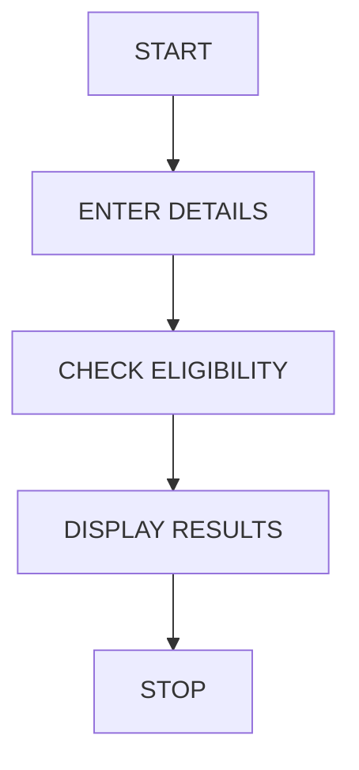

# University Scholarship Allocation System Using Python

## 1. PROBLEM STATEMENT
To evaluate scholarship applicants based on aggregate marks, subject-wise minimum marks, attendance and family income. Select eligible students, rank them and resolve ties using predefined rules.

## 2. ALGORITHM
1. Start.
2. Enter student details.
3. Check aggregate marks.
4. Check subject-wise minimum marks.
5. Check attendance and family income.
6. Select eligible students.
7. Rank students based on aggregate marks.
8. Resolve ties using attendance.
9. Display results.
10. Stop.
## 3. FLOWCHART

## 5. SAMPLE INPUT
Enter number of students: 3
Name: Ravi
Marks Subject Attendance Income: 85 60 90 150000
Name: Sita
Marks Subject Attendance Income: 90 70 95 100000
Name: Rani
Marks Subject Attendance Income: 65 55 80 120000
## 6. SAMPLE OUTPUT
Sita Scholarship Rank: 1
Ravi Scholarship Rank: 2
