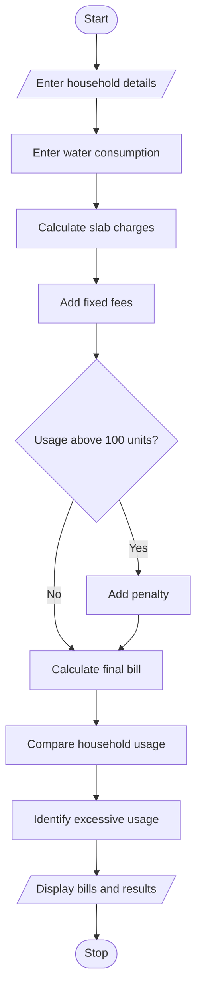

## 1. PROBLEM STATEMENT
To develop a Progressive Water Tariff Analysis system that calculates water bills for multiple households based on consumption slabs, fixed fees, and penalties. It compares water usage and identifies households with excessive consumption.
## 2. ALGORITHM
1. Start.
2. Enter the number of households.
3. Enter household name and water consumption.
4. Calculate charges using consumption slabs.
5. Add fixed fees.
6. Apply penalties for excessive usage.
7. Calculate the final bill.
8. Compare household consumption.
9. Identify excessive water usage.
10. Stop.
## 3. FLOWCHART 

## 5. SAMPLE INPUT
Enter number of households: 3
Household name: Ravi
Enter water units: 40
Household name: Sita
Enter water units: 120
Household name: Raju
Enter water units: 80
## 6. SAMPLE OUTPUT
Ravi Bill: 130 Normal
Sita Bill: 570 Excessive
Raju Bill: 270 Normal
Highest usage: Sita

