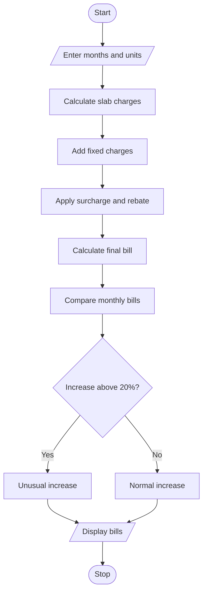

# Progressive Electricity Billing System Using Python

## 1. Problem Statement

To calculate electricity bills using different consumption slabs, fixed charges, surcharges and rebates. Compare monthly bills and identify unusual increases.

## 2. Algorithm

1. Start.
2. Enter the number of months.
3. Enter electricity units.
4. Calculate slab charges.
5. Add fixed charges and surcharge.
6. Apply rebate if units are below 100.
7. Calculate the final bill.
8. Compare monthly bills.
9. Identify unusual increases.
10. Stop.

## 3. Flowchart

## 5. Sample Input

Enter months: 2
Enter units: 80
Enter units: 150

## 6. Sample Output

Bill: 249.38
Bill: 577.5
Unusual increase!

