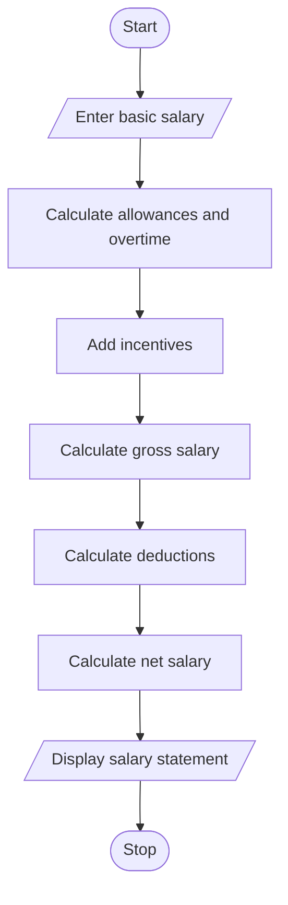

Employee Payroll and Deduction Analysis Using Python

## 1. Problem Statement

To calculate an employee's gross salary using basic pay, allowances, overtime and incentives. Apply deductions and display the final net salary.

## 2. Algorithm

1. Start.
2. Enter basic salary.
3. Calculate allowances, overtime and incentives.
4. Calculate gross salary.
5. Apply salary deductions.
6. Calculate net salary.
7. Display salary statement.
8. Stop.

## 3. Flowchart 

## 4. Sample Input

Enter basic salary: 20000
Enter overtime amount: 2000
Enter incentive: 1000

## 5. Sample Output

Gross: 27000.0
Deduction: 1700.0
Net Salary: 25300.0

## 6. Conclusion

This program calculates gross salary, deductions and net salary to generate an employee payroll statement.
