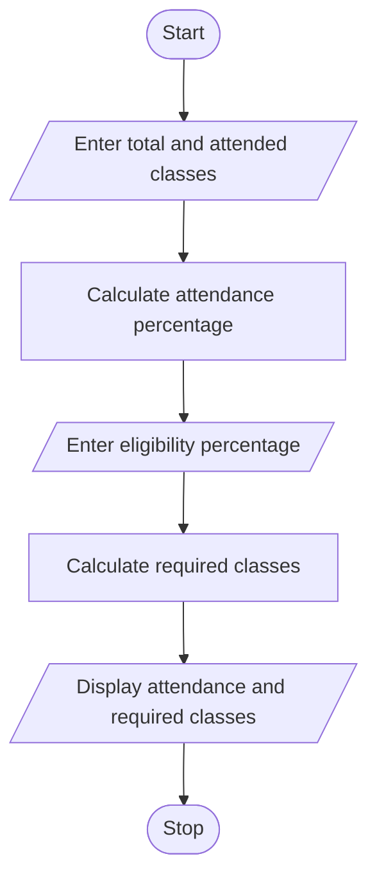

## 1. PROBLEM STATEMENT
To calculate the current attendance percentage of a student and find the minimum number of consecutive classes required to reach the eligibility threshold of 75%.
## 2. ALGORITHM
1. Start.
2. Enter total classes and attended classes.
3. Calculate current attendance percentage.
4. Enter eligibility percentage.
5. Calculate the minimum required classes.
6. Display attendance percentage and required classes.
7. Stop.
## 3. FLOWCHART 

## 5. SAMPLE INPUT
Total classes: 40
Attended classes: 25
## 6. SAMPLE OUTPUT
Attendance: 62.5 %
Required classes: 20

