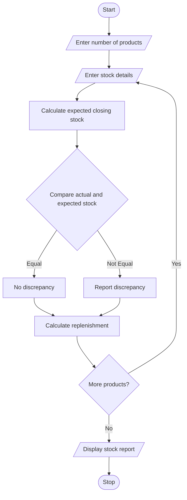

## 1. PROBLEM STATEMENT
To compare opening stock, incoming quantities, dispatched quantities, and closing stock of multiple products, identify stock discrepancies, and calculate the replenishment requirements.
## 2. ALGORITHM
1. Start.
2. Enter the number of products.
3. Enter product name and stock details.
4. Calculate expected closing stock.
5. Compare expected stock with actual closing stock.
6. Identify stock discrepancies.
7. Calculate replenishment quantity.
8. Display the stock report.
9. Stop.
## 3. FLOWCHART 

## 5. SAMPLE INPUT
Number of products: 2
Product name: Pen
Opening, Incoming, Dispatched, Closing: 100 50 30 120
Product name: Book
Opening, Incoming, Dispatched, Closing: 80 20 40 50
## 6. SAMPLE OUTPUT
Product: Pen
Discrepancy: 0
Replenishment: 0

Product: Book
Discrepancy: 10
Replenishment: 0
