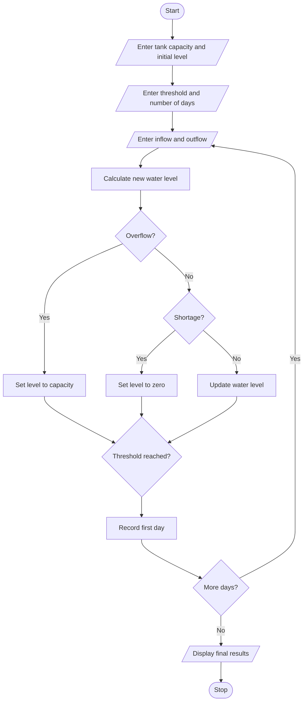

## 1. PROBLEM STATEMENT
To simulate water tank levels over multiple days by calculating inflow and outflow, updating water levels, detecting overflow and shortages, and identifying the first day the tank reaches a specified threshold.
## 2. ALGORITHM
1. Start.
2. Enter tank capacity and initial water level.
3. Enter the required threshold.
4. Enter the number of days.
5. Enter daily inflow and outflow quantities.
6. Calculate the new water level.
7. Detect overflow and water shortages.
8. Check whether the threshold is reached.
9. Display water level and results.
10. Stop.
## 3. FLOWCHART 

## 5. SAMPLE INPUT
Tank capacity: 1000
Initial water level: 400
Required threshold: 700
Number of days: 3
Inflow and outflow: 300 100
Inflow and outflow: 200 50
Inflow and outflow: 100 200
## 6. SAMPLE OUTPUT
Day 1 Water level: 600
Day 2 Water level: 750
Day 3 Water level: 650
First threshold day: 2

