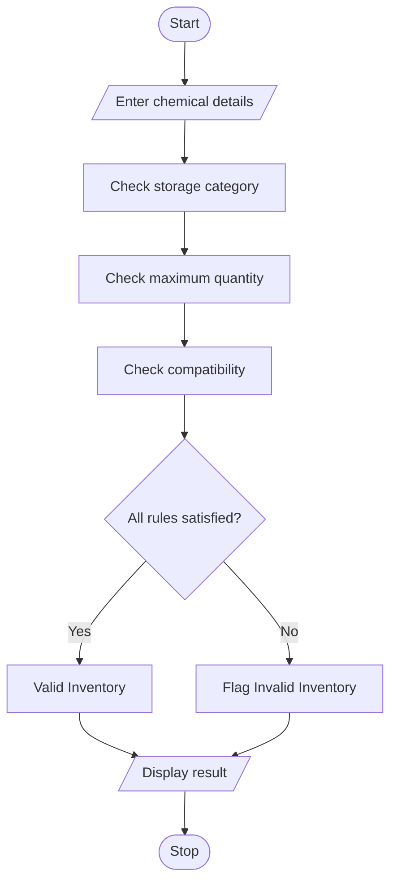

## 1. PROBLEM STATEMENT
To develop a Laboratory Chemical Inventory Validation system that checks chemical storage categories, maximum permitted quantities, and compatibility restrictions. It identifies invalid chemical combinations and displays the validation result.
## 2. ALGORITHM
1. Start.
2. Enter the number of chemicals.
3. Enter chemical name, category, and quantity.
4. Check the storage category.
5. Check the maximum quantity limit.
6. Check chemical compatibility.
7. Identify invalid combinations.
8. Display validation results.
9. Stop.
## 3. FLOWCHART 

## 5. SAMPLE INPUT
Enter number of chemicals: 3
HCl acid 30
NaOH base 20
Ethanol solvent 25
## 6. SAMPLE OUTPUT
Valid chemicals: ['acid', 'solvent']
Invalid chemicals: ['NaOH']

