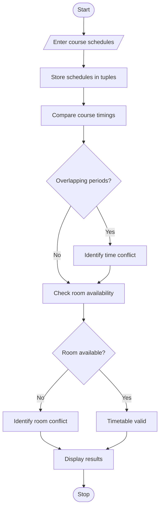

## 1. PROBLEM STATEMENT
To develop a Student Timetable Conflict Detection system that compares course schedules using strings and tuples. It detects overlapping class periods, identifies unavailable rooms, and checks whether the proposed timetable is valid.
## 2. ALGORITHM
1. Start.
2. Enter course schedule details.
3. Store schedules using tuples.
4. Compare course timings.
5. Check overlapping periods.
6. Check room availability.
7. Identify timetable conflicts.
8. Display validation results.
9. Stop.
## 3. FLOWCHART

## 5. SAMPLE INPUT
Enter number of classes: 3
Math Mon 09:00 10:00 R1
Physics Mon 09:30 10:30 R2
Chemistry Tue 10:00 11:00 R1
## 6. SAMPLE OUTPUT
Conflicts: ['Physics']
Timetable: Invalid
