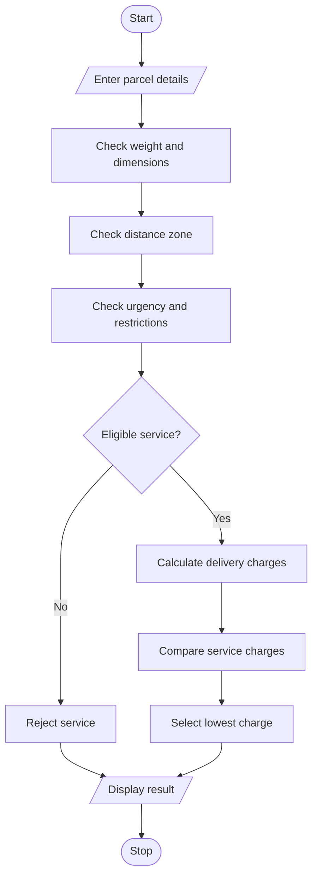

## 1. PROBLEM STATEMENT
To develop a Courier Charge Optimization system that calculates delivery charges based on parcel weight, dimensions, distance zones, urgency, and restrictions. It compares different courier services and selects the most suitable eligible service.
## 2. ALGORITHM
1. Start.
2. Enter parcel weight and dimensions.
3. Enter distance zone.
4. Enter delivery urgency.
5. Check parcel restrictions.
6. Calculate courier charges.
7.
8. Compare available service options.
9. Select the eligible service with the lowest charge.
10. Display delivery charges and selected service.
11. Stop.
## 3. FLOWCHART

## 5. SAMPLE INPUT
Enter parcel weight: 5
Enter distance zone (1-3): 2
Enter urgency (normal/express): normal
Restricted parcel? (yes/no): no
## 6. SAMPLE OUTPUT
Selected: Standard Charge: Rs. 110.0

These are assumed charges and restrictions for a programming exercise.
